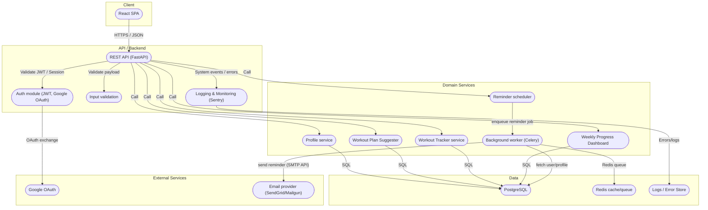
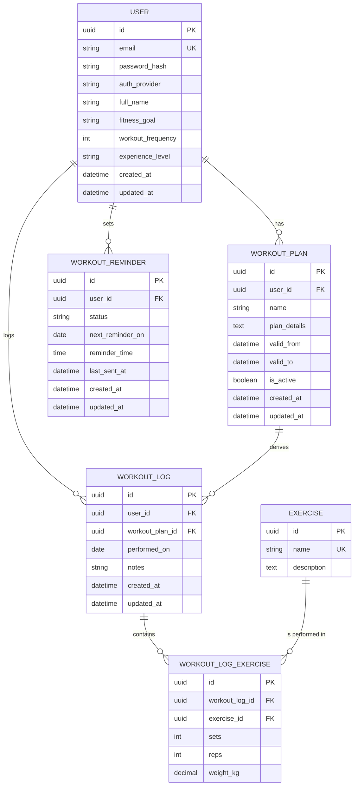
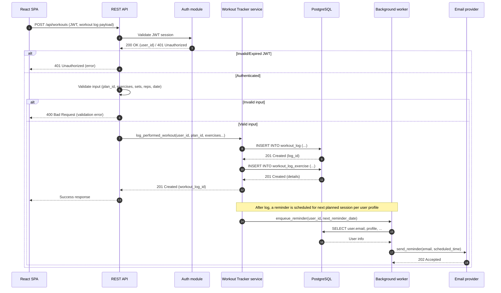

# Gym Workout Planner App

> Stay on track with personalized workout plans!

A low-fidelity prototype of **Gym Workout Planner App**, generated by an agentic AI project manager from a stakeholder conversation in Slack.

## Screens

- [Home](index.html) — Users can navigate to different features of the app.
- [Create User Profile](create_profile.html) — Users can set up their fitness profile and goals.
- [Suggest Workout Plan](workout_plan.html) — Users receive personalized workout suggestions based on their profile.
- [Track Workouts](track_workouts.html) — Users can log and monitor their workout progress.
- [Dashboard for Weekly Progress](progress_dashboard.html) — Users see a summary of their weekly workout achievements.
- [Send Workout Reminders](reminders.html) — Users can view and manage their workout reminders.

## What this prototype fakes

- This prototype is a visual and interaction design only; it does not connect to a backend.
- All data entry and actions are simulated and do not persist between sessions.

## System design

### Layered System Architecture for Gym Workout Planner

This diagram shows the system architecture, split into clear layers: Client (React SPA), API/Backend (FastAPI REST API with authentication, validation, monitoring), Service modules (profile, workout plan, tracking, reminders), Data (PostgreSQL, Redis for Celery, logging), and External integrations (Google OAuth, email provider for reminders). Each major feature area is a backend service module. Data and job flows (HTTPS, SQL, job queues, SMTP) are labelled for traceability and transparency. Cross-cutting concerns—such as auth, logging, background jobs, caching—are explicit, so dependencies and extensibility points are obvious for future development.

### Entity-Relationship Diagram for Core Workout App Domain

This ERD lists all core entities for version 1. User is primary, holding credentials and profile attributes. A User can have many WorkoutPlans (which describe suggested routines), and WorkoutLogs which record performed sessions. Each WorkoutLog can contain multiple Exercises (with join table since an exercise can appear in many logs), and WorkoutReminders are joined to the User for notification scheduling. Relational keys, unique attributes, and business fields (goal, frequency, status, timestamps, etc.) are fleshed out per requirements—ensuring strong normalization and accurate referential mapping for domain operations.

### End-to-End Sequence: Log Performed Workout and Trigger Reminder

This detailed sequence traces the user logging a completed workout via the web app. Messages pass through UI input, API validation (with JWT session verification), WorkoutTracker service (which persists the log, triggers plan progress), and background job scheduling for reminders. The sequence includes error handling for input validation (invalid or missing data), authentication (invalid token), and notes the policy for reminder-triggering. Each participant is explicit and every real interface and persistence layer is called out, making the core data and process flow easy to follow for implementors.

## Running it

Every file is static. Open `index.html`, or serve the directory with any static file server.
